<div align="center">

# FootIQ

**An AI football operating system, not another scores site.**

Every screen infers, compares, explains or predicts, and shows what it was built from.

[**Live site → footiq-omega.vercel.app**](https://footiq-omega.vercel.app)


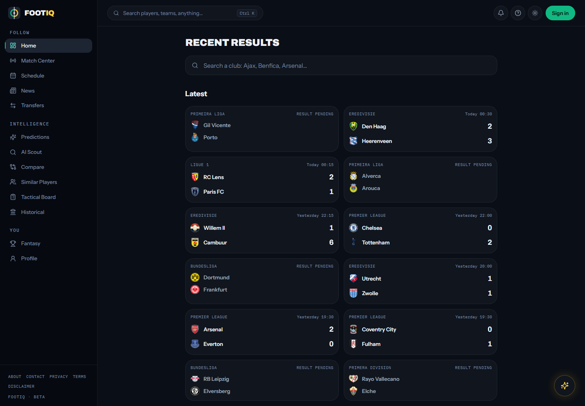

</div>

---

## Why FootIQ

Scores sites tell you *what* happened. FootIQ is built for serious fans and tactics nerds who want to know *why*, and what's likely next. It covers real fixtures, real Premier League player data and real news, with a model layer on top that never pretends to be fact.

**The honesty rule.** Two accent colours carry meaning across the whole app:

| Colour | Means | Example |
|---|---|---|
| 🟢 **Emerald** `#10b981` | Measured fact | Scores, minutes, goals per game, league position |
| 🟡 **Amber** `#fbbf24` | Model inference | Win probabilities, fit scores, AI explanations |

Every AI output carries its date, its sources, and a chip when it comes from the demo engine.

## Tour

<table>
  <tr>
    <td width="50%">
      <h3>Match facts</h3>
      <p>Full-time score, each side's form going into the match, key players and venue info. Built from free data.</p>
      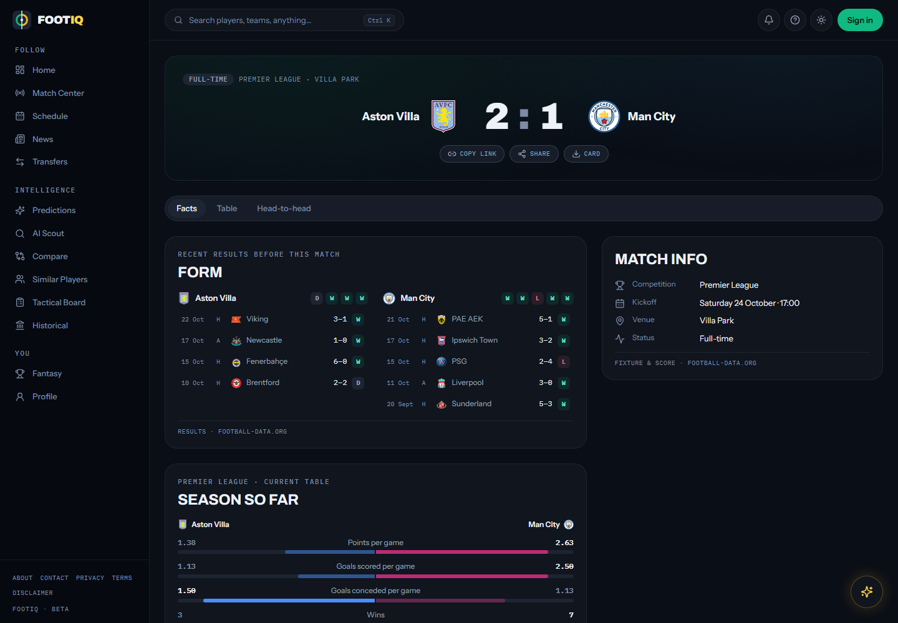
    </td>
    <td width="50%">
      <h3>AI predictions</h3>
      <p>A Poisson goals model fed by this season's real tables. Probabilities sit beside the numbers they came from.</p>
      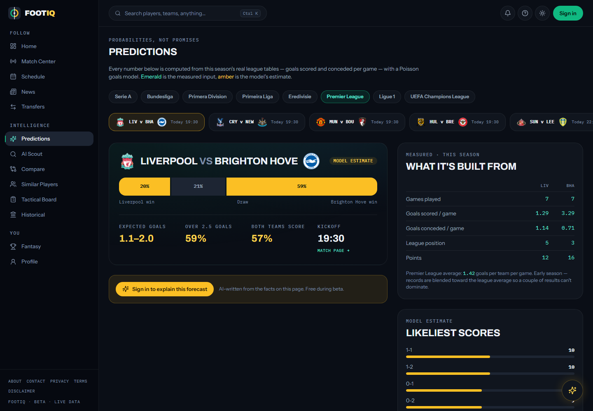
    </td>
  </tr>
  <tr>
    <td>
      <h3>Player profiles</h3>
      <p>Season totals from official FPL data, with per-90 percentile radars against players in the same position.</p>
      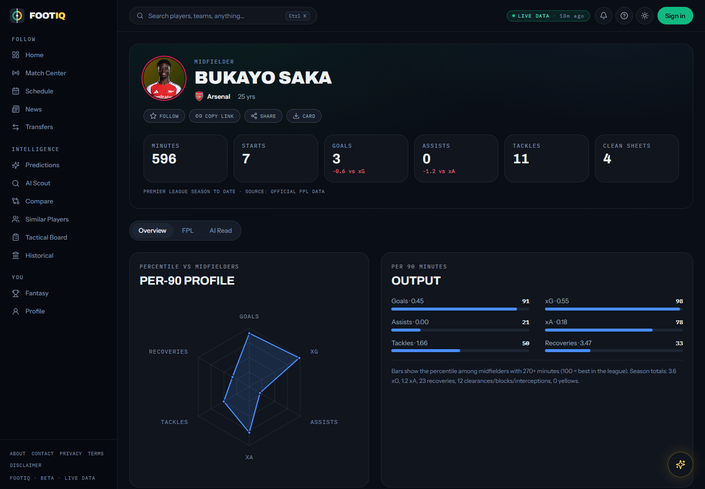
    </td>
    <td>
      <h3>Compare anything</h3>
      <p>Players, teams or managers side by side, with the biggest per-90 gaps called out.</p>
      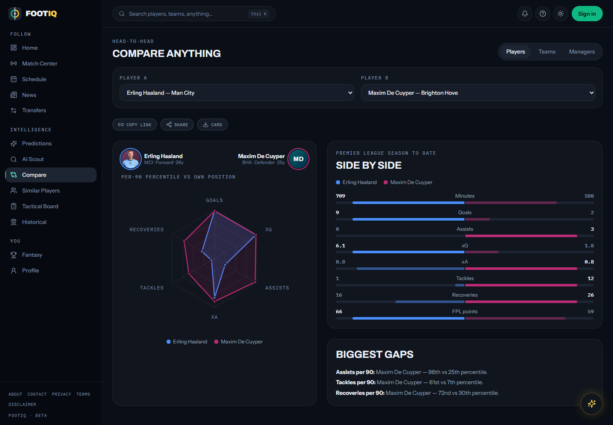
    </td>
  </tr>
  <tr>
    <td>
      <h3>AI Scout</h3>
      <p>Describe a player in plain English (or by voice) and get ranked matches with a fit score.</p>
      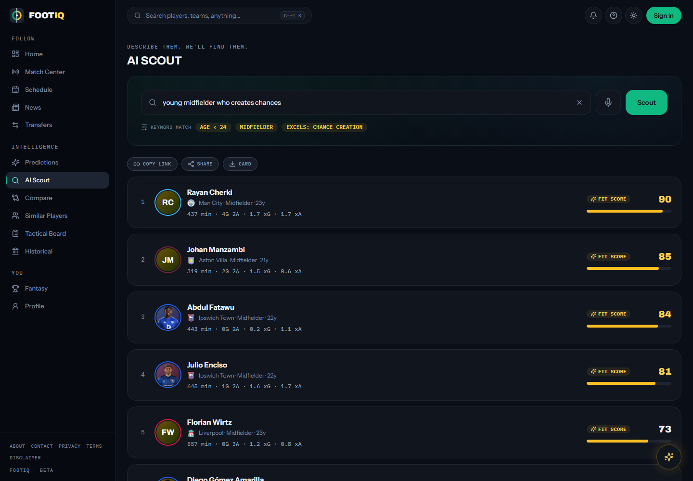
    </td>
    <td>
      <h3>Tactical board</h3>
      <p>Drag players into a shape. The model reads line height, compactness and width, then gives coach's feedback.</p>
      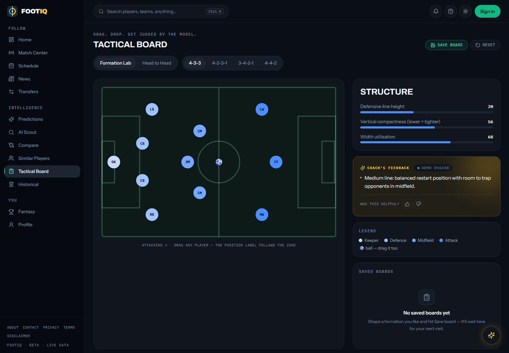
    </td>
  </tr>
  <tr>
    <td>
      <h3>Team pages</h3>
      <p>Table position, form, most-used players and the registered squad.</p>
      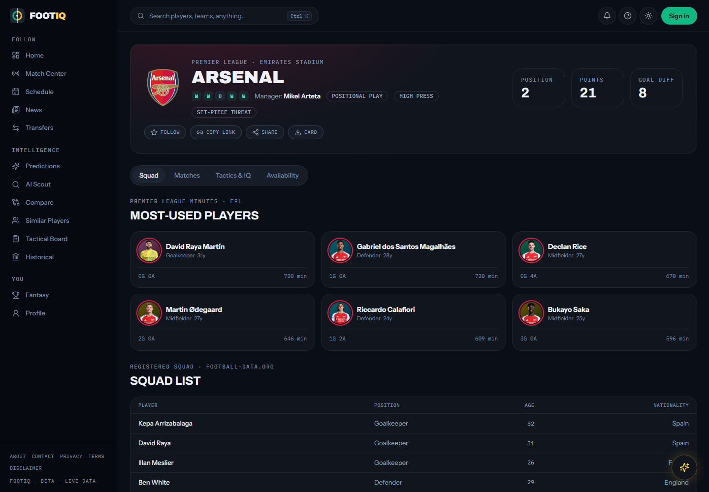
    </td>
    <td>
      <h3>Fantasy assistant</h3>
      <p>Captain candidates, transfer trends, and injury alerts and differentials from the official FPL feed.</p>
      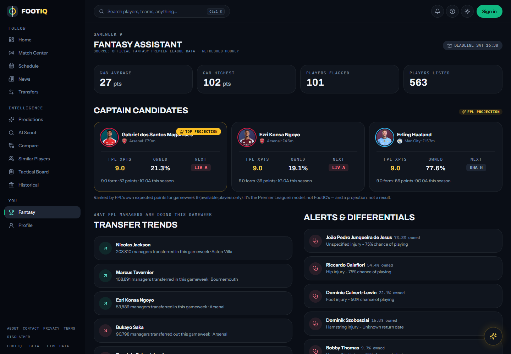
    </td>
  </tr>
  <tr>
    <td>
      <h3>News</h3>
      <p>Headlines from BBC Sport, The Guardian and Sky Sports, refreshed every 30 minutes and auto-categorised.</p>
      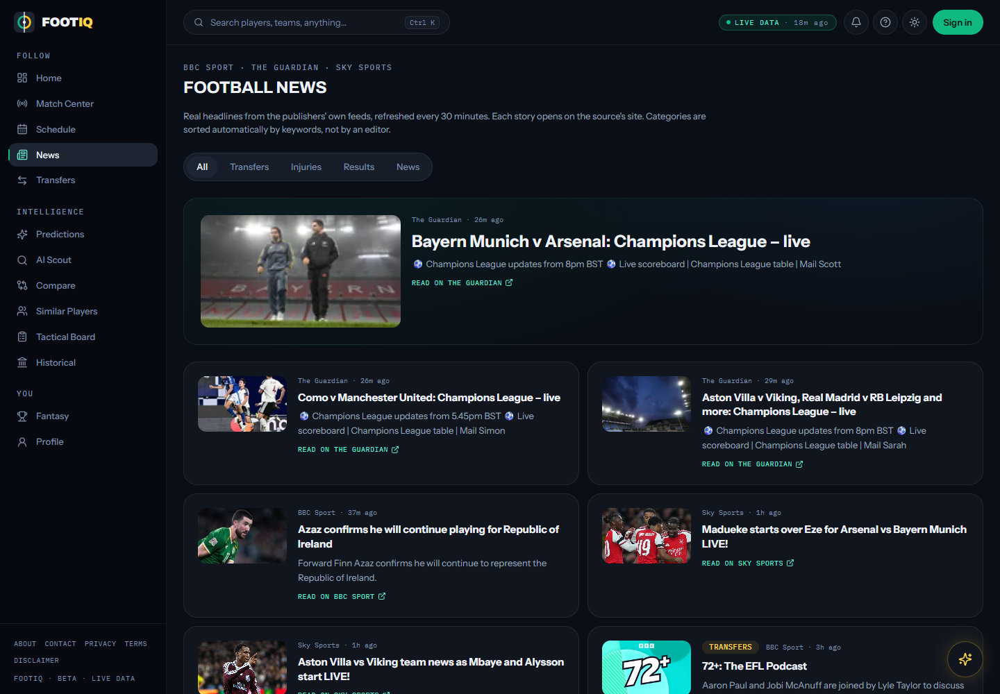
    </td>
    <td>
      <h3>Historical explorer</h3>
      <p>A searchable timeline of iconic matches, with the odds each one beat. This section uses illustrative sample data and is labelled as such.</p>
      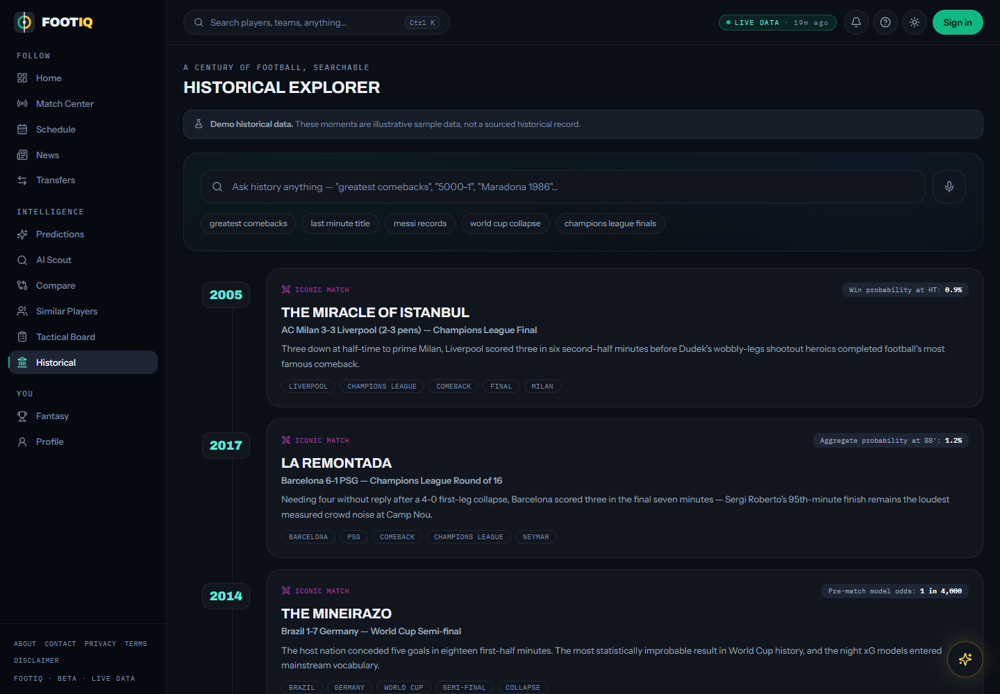
    </td>
  </tr>
</table>

Also included: schedule, transfer centre, similar players, intelligence articles, universal search (<kbd>Ctrl</kbd>+<kbd>K</kbd>), an AI concierge chat that cites the news articles it answers from ([how](#cited-answers-rag)), notifications and watchlists.

### Light theme and mobile

<table>
  <tr>
    <td width="64%">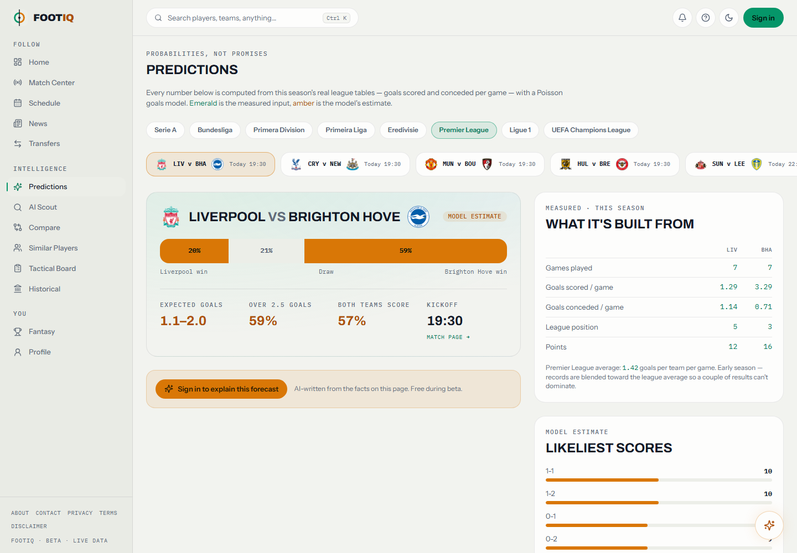</td>
    <td width="18%">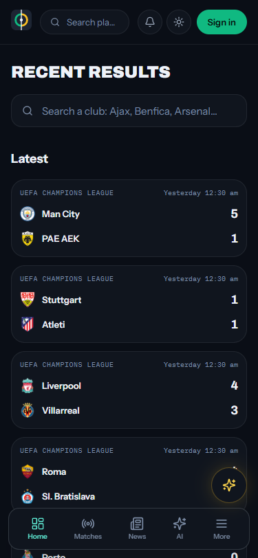</td>
    <td width="18%">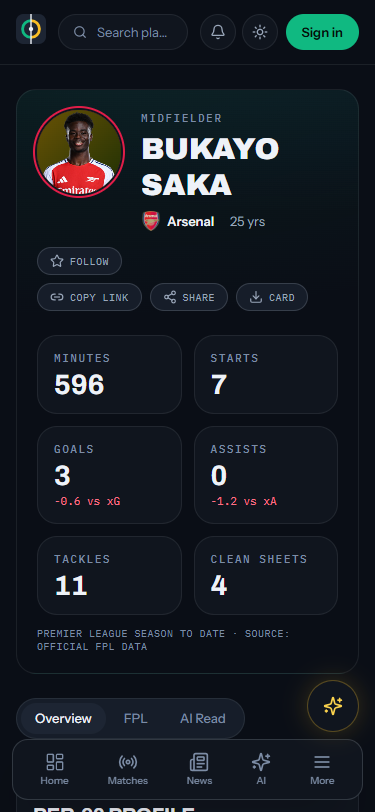</td>
  </tr>
</table>

The site has dark and light themes and a bottom nav on phones. It aims for WCAG 2.1 AA: full keyboard support, reduced motion respected, and chart colours checked for colour-blind readability on both themes.

## How it works

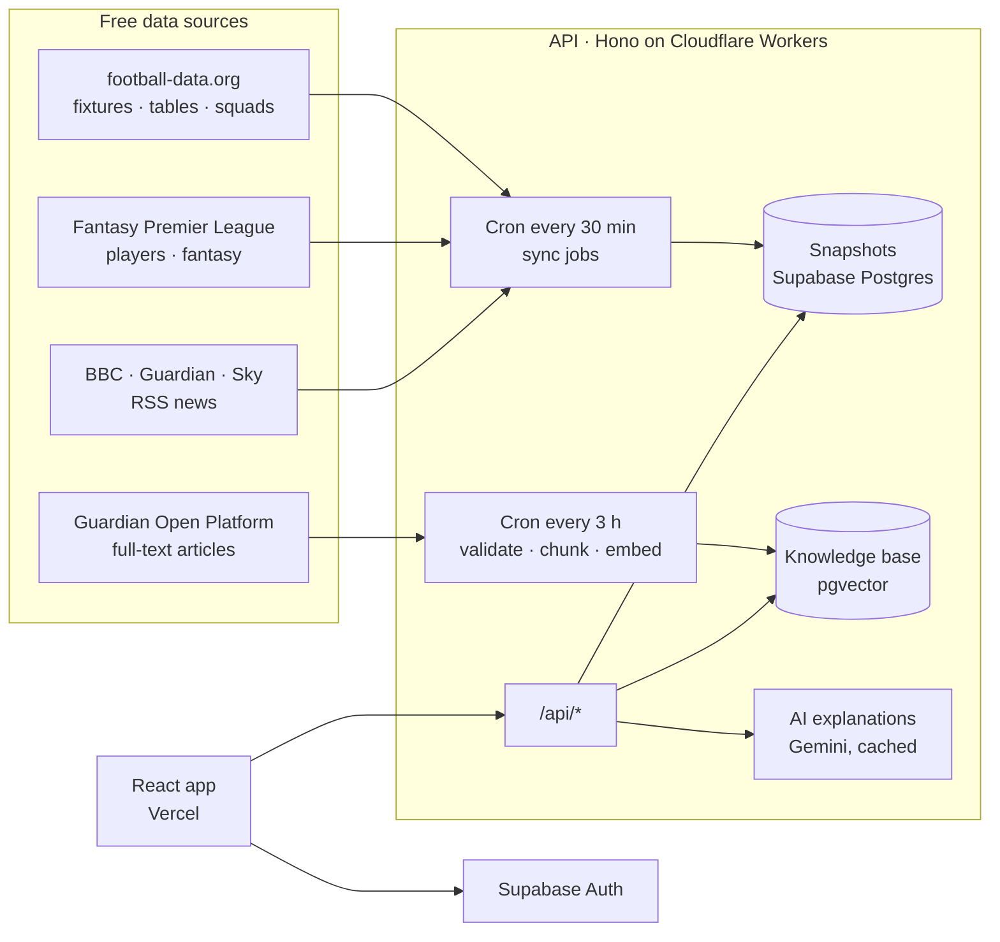

- **Live requests never hit external APIs.** Cron jobs sync providers into snapshots, and the API only serves those snapshots, so free-tier quotas depend on cron frequency, not traffic.
- **Graceful degradation.** If a provider fails, the last snapshot stays. With no backend at all, the frontend falls back to bundled demo data.
- **Competitions:** Premier League, La Liga, Bundesliga, Serie A, Ligue 1, Eredivisie, Primeira Liga and the Champions League.

## Cited answers (RAG)

The concierge chat answers from two kinds of material. The first is FootIQ's own data: tables, fixtures, forecasts and FPL stats. The second is published news. For news, it retrieves passages from Guardian match reports and articles, and every claim taken from them ends in a numbered citation that links to the article. If neither source covers the question, it says FootIQ doesn't hold that rather than guessing.

<table>
  <tr>
    <td width="50%">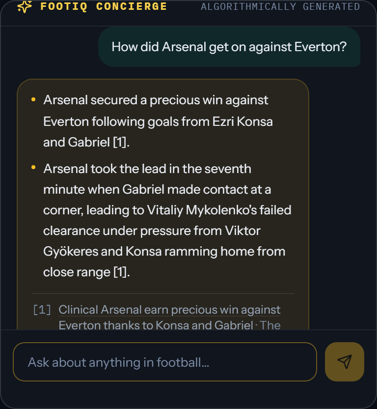</td>
    <td width="50%">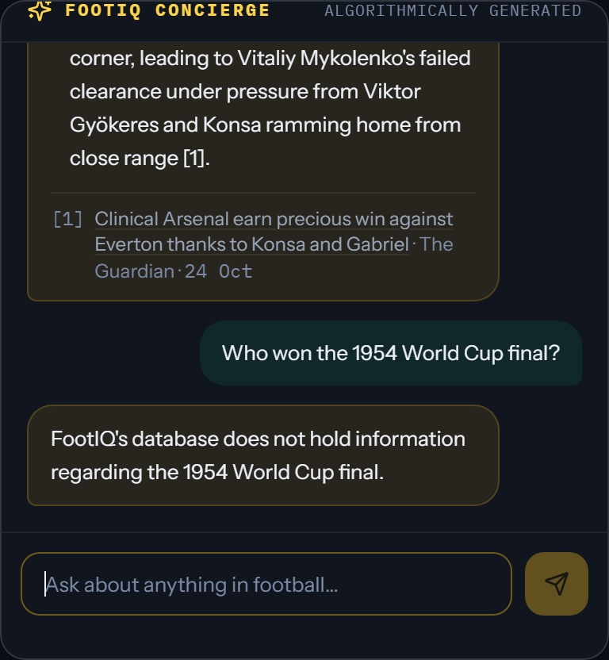</td>
  </tr>
  <tr>
    <td>Each claim is cited to the match report it came from.</td>
    <td>The source links out to the Guardian. A question the articles don't cover gets "doesn't hold", not a guess.</td>
  </tr>
</table>

```
Guardian articles → validate → chunk (~150 words) → embed (Gemini, 768-d) → pgvector
question → embed → nearest chunks (floor 0.6, ≤2 per article, top 6) → answer with [n] → checked citations
```

- **Validated source.** Each article is either indexed or rejected for a named reason: empty, too short, too old, a TV-listing page, already held, or a duplicate of text already stored. The reason counts are logged on every run.
- **Citations that can't lie.** A citation pointing at a passage that wasn't retrieved is deleted before the answer reaches you. The chat shows the title, publisher and a link, never the article text.
- **Measured, not guessed.** The test set has 30 hand-checked questions over 15 pinned articles, plus 6 unanswerable ones. Both settings were tuned by sweeping them against that set:

| Setting | hit@1 | recall@6 | MRR | Off-topic questions retrieving nothing |
|---|---|---|---|---|
| First guess (floor 0.5, no cap) | 86.7% | 96.7% | 0.917 | 0% |
| Shipped (floor 0.6, ≤2 chunks per article) | 86.7% | **100%** | **0.925** | **83%** |

Method, sweeps and known limits: [`docs/RAG.md`](docs/RAG.md).

## Quick start

```bash
npm install
npm run dev      # http://localhost:5173
```

With no environment variables, the app runs fully offline on bundled demo data. To run the API locally as well:

```bash
cd server
npm install
cp .env.example .env
npm run dev      # API on http://localhost:8787
```

Then point the frontend at it with `VITE_API_URL=http://localhost:8787` in `.env.local`. See [`docs/ENVIRONMENT.md`](docs/ENVIRONMENT.md) for every variable and the mode matrix (demo → API → Supabase → real AI → live data).

### Scripts

| Command | What it does |
|---|---|
| `npm run dev` | Vite dev server |
| `npm run build` | Type-check and build to `dist/` |
| `npm run preview` | Serve the production build |
| `npm test` | Vitest unit tests |
| `npm run verify` | Import check, then a headless sweep of every route on desktop and phone sizes: screenshots, console errors, overflow (needs `npm run dev`) |
| `npm run og` | Regenerate the Open Graph share image |

`npm run verify` can also sweep a deployed build: `VERIFY_BASE=https://footiq-omega.vercel.app npm run verify`. The screenshots in this README came from that sweep.

## Tech stack

| Layer | Choice |
|---|---|
| Frontend | Vite 7, React 19, TypeScript (strict), react-router 7, lazy-loaded routes |
| Styling | Tailwind CSS v4 with CSS-first tokens in [`src/styles/global.css`](src/styles/global.css) |
| Motion | `motion` (Framer Motion), used only to show state changes |
| Charts | Hand-rolled SVG: radar, bars, pitch, gauges. No chart library |
| API | Hono on Cloudflare Workers ([`server/`](server/)), zod-validated contracts in [`shared/`](shared/) |
| Data and auth | Supabase Postgres with RLS ([`supabase/migrations/`](supabase/migrations/)) and Supabase Auth |
| Hosting | Vercel (frontend, deploys on push to `main`) and Cloudflare Workers (API, deployed by GitHub Actions) |

## Project structure

```
src/
  pages/        one file per route
  components/   UI kit, charts, shell (sidebar, search, chat dock)
  lib/          repositories, hooks, SEO, auth, stats maths
  data/         demo dataset + image resolvers
  styles/       design tokens
server/src/
  providers/    football-data.org, FPL, RSS news, Guardian, demo
  jobs/         sync jobs and registry (retry, overlap guard, per-job cron)
  routes/       /api/* endpoints
  ai/           AI providers, prompts, cache
  ai/rag/       knowledge base: validate, chunk, embed, retrieve, citations
  ai/evals/     prompt golden set + retrieval eval (hit@1, recall@k, MRR)
shared/         request/response contracts shared by app and API
supabase/       SQL migrations
docs/           architecture, API, data, deployment, security…
```

## Design

The visual system is called **"The Floodlit Instrument"**: deep indigo night surfaces, chalk-white type, flat tonal layers with hairline borders and no shadows, and tabular mono numerals. The type stack is Archivo (display), Instrument Sans (body) and IBM Plex Mono (data). Read [`PRODUCT.md`](PRODUCT.md) for the strategy and [`DESIGN.md`](DESIGN.md) for the full system.

## Documentation

| Doc | Covers |
|---|---|
| [ARCHITECTURE](docs/ARCHITECTURE.md) | System overview, start here |
| [API](docs/API.md) | Endpoint reference |
| [DATA](docs/DATA.md) | Providers, sync pipeline, caching, jobs |
| [RAG](docs/RAG.md) | Knowledge source and its validation, retrieval pipeline, eval results |
| [DATABASE](docs/DATABASE.md) | Schema and RLS |
| [ENVIRONMENT](docs/ENVIRONMENT.md) | All env vars and the mode matrix |
| [DEPLOYMENT](docs/DEPLOYMENT.md) · [RUNBOOK](docs/RUNBOOK.md) | Shipping and operating it |
| [SECURITY](docs/SECURITY.md) · [TESTING](docs/TESTING.md) | Checklists and test strategy |
| [ONBOARDING](docs/ONBOARDING.md) | New contributor guide |

## Data and attribution

Football data provided by the [Football-Data.org](https://www.football-data.org) API. Player and fantasy data come from the official Fantasy Premier League API. News headlines link back to their publishers. Cited chat answers draw on articles from the [Guardian Open Platform](https://open-platform.theguardian.com) under a non-commercial developer key: article text is used only for retrieval, and every citation links to theguardian.com. Club crests and player photos belong to their respective owners. FootIQ is an independent beta and is not affiliated with any league, club or publisher. Predictions are probabilities, not betting advice.
